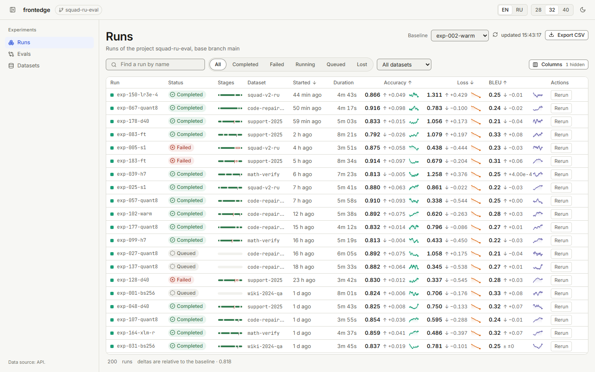
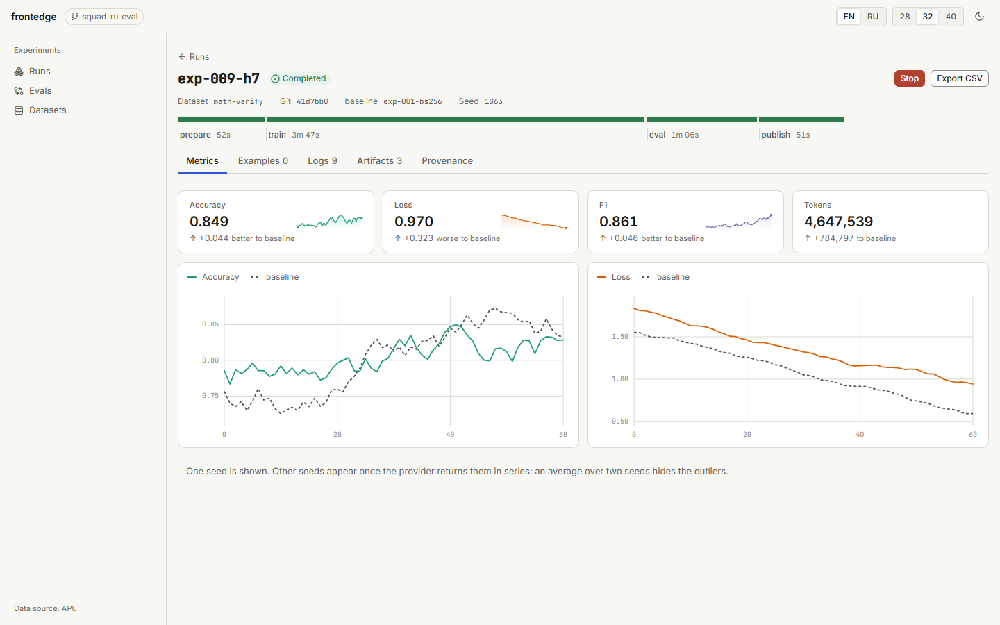

# frontedge

**Фронтенд-слой для ML-инжиниринга.** Готовый интерфейс — прогоны, метрики, оценки,
датасеты, логи, артефакты, провенанс, — который ты монтируешь в своё FastAPI-приложение и
наполняешь своими данными.

```python
from fastapi import FastAPI
import frontedge

app = FastAPI()
app.include_router(frontedge.mount(my_runs_provider))
```

[](LICENSE)
[](https://pypi.org/project/frontedge/)
[](https://www.npmjs.com/package/@frontedge-ml/ui)
[](https://pypi.org/project/frontedge/)
[](package.json)
[](https://github.com/socrabs151/frontedge-ml/actions/workflows/ci.yml)

[English](README.md) · **Русский**

---

## Проблема

Каждый ML-проект заново пишет один и тот же интерфейс: таблицу прогонов, детали с графиками
метрик, сравнение двух оценок, просмотр датасета. Экраны — не самая сложная часть; сложна
обвязка: достать прогоны, держать закреплённый эталон, стримить логи, сопоставить примеры
между двумя прогонами, показать дельту метрики **вместе с её направлением** — и всё это без
дизайнера в контуре.

Frontedge — этот слой, упакованный.



## Что внутри

| | |
|---|---|
| **Runs** | плотная таблица: таймлайны стадий, дельты к закреплённому эталону, спарклайны метрик прямо в строке. Состав колонок, фильтры, пагинация и живое обновление настраиваются тобой |
| **Детали прогона** | метрики по шагам, оценка на примерах, живые логи по SSE, артефакты, провенанс и причина, по которой прогон упал |
| **Eval diff** | два прогона, сопоставленные по примерам: примеры-строки, колонки по ролям, эталон закреплён слева |
| **Dataset** | версии, примеры, datasheet (мотивация, состав, сбор, применения) и провенанс |
| **Дизайн-система** | токены, примитивы и ML-паттерны: плотность, тёмная тема, работа с клавиатуры, контраст по WCAG, английский с тумблером на русский |



## Быстрый старт

Пакет опубликован на PyPI и уже содержит собранный интерфейс:

```bash
pip install frontedge
```

Дальше — скаффолд: он работает на демо-данных, ещё до вашего кода.

```bash
frontedge init my-dashboard
cd my-dashboard && uvicorn app:app --reload
```

Или напишите провайдер сами — это одна функция:

```python
from datetime import UTC, datetime
from fastapi import FastAPI, Request
import frontedge

app = FastAPI()


async def my_runs_provider(request: Request) -> list[frontedge.Run]:
    # Авторизация — здесь: библиотека передаёт тебе request.
    return [
        frontedge.Run(
            id=str(row.id),
            name=row.name,
            status=frontedge.RunStatus(row.status),
            dataset=row.dataset,
            git_sha=row.git_sha,
            started_at=row.started_at,
            duration_ms=row.duration_ms,
            owner=row.owner,
            metrics={"accuracy": row.accuracy, "loss": row.loss},
            series={"accuracy": row.accuracy_curve},
            metric_direction={"accuracy": "maximize", "loss": "minimize"},
            stages=row.stages,
        )
        for row in await my_repository.fetch_runs(request.user)
    ]


app.include_router(frontedge.mount(my_runs_provider))
```

Один процесс, один порт: интерфейс и API отдаёт одно и то же приложение.

## Как расширять

Интерфейс не придумывает, что делает кнопка. Проект объявляет, что умеет, а библиотека
это вызывает:

```toml
# frontedge.toml
[[actions]]
id = "stop"
label = "Остановить"
placement = "run"
danger = true
```

```python
async def stop_run(request, payload) -> frontedge.ActionResult:
    await my_repository.stop(payload["runId"])
    return frontedge.ActionResult(ok=True, message=f"Прогон {payload['runId']} остановлен")

app.include_router(frontedge.mount(provider, actions={"stop": stop_run}, config="frontedge.toml"))
```

Кнопки появляются только для объявленных действий — мёртвых кнопок не бывает. Наборы
колонок, вкладки и действия живут в конфигурации, а конфигурация — это данные, а не код:
её одинаково легко править руками и инструментом позже.

Тот же файл решает, что показывает список и как он себя ведёт:

```toml
# frontedge.toml
density = "default"
run_columns = ["name", "status", "ribbon", "dataset", "accuracy", "bleu"]
baseline_run = "exp-039"
live_refresh_seconds = 5
page_size = 50

[[metrics]]
id = "bleu"
label = "BLEU"
direction = "maximize"
digits = 2
```

Любая метрика проекта становится полноценным объектом: добавь `bleu` в `run_columns` — появится
колонка с дельтой к эталону; объяви её в `[[metrics]]` — на экране прогона появится карточка и
график по её ряду. Если провайдер принимает `list_runs(request, query)`, фильтрация, поиск и
пагинация выполняются на сервере.

Для своих экранов поставь дизайн-систему (`npm i @frontedge-ml/ui react react-dom`) и используй
компоненты напрямую:

```tsx
import "@frontedge-ml/ui/styles.css";
import { RunsTable, StatusBadge } from "@frontedge-ml/ui";
```

Полный контракт: **[docs/integration.md](docs/integration.md)**. Если ты агент и работаешь в
репозитории пользователя — **[AGENTS.md](AGENTS.md)** содержит тот же контракт в сжатом виде.

## Два пакета

| | |
|---|---|
| [`frontedge`](python/frontedge) (PyPI) | Python-пакет: модели, провайдеры, роутеры, генератор типов |
| [`@frontedge-ml/ui`](packages/ui) (npm) | дизайн-система: токены, примитивы, ML-паттерны, сгенерированные типы |

TypeScript-типы генерируются из Python-моделей, поэтому разойтись не могут:

```bash
pnpm gen:types     # pydantic -> types.ts + client.ts
```

## Принципы дизайна

- **Данные вместо украшений.** Статус — иконка + слово + цвет, никогда только цвет. «Лучше» и
  «хуже» — знак и слово: направление метрики задаёт владелец, а не интерфейс.
- **Таблицы, а не карточки.** Соседние значения должны сравниваться без перевода взгляда.
- **Плотно, но спокойно.** Шаг 4px, hairline-разделители, один акцент, без теней на
  поверхностях.
- **Доступность по построению.** Каждая пара токенов проверяется по WCAG 2.2 в CI; браузерные
  гейты гоняют axe и клавиатурный прогон на каждом pull request.
- **Один язык за раз.** Интерфейс английский по умолчанию, с тумблером на русский. Доменные
  термины (Run, Dataset, Baseline) остаются английскими в обоих языках — это слова, по
  которым ищут в W&B и MLflow.

## Разработка

```bash
pnpm install
pnpm dev                # спайк на http://localhost:5173
pnpm demo               # демо на FastAPI: http://127.0.0.1:8000/frontedge
pnpm typecheck
pnpm check:contrast     # контраст каждой пары токенов по WCAG 2.2, обе темы
pnpm check:lang         # английский репозиторий и интерфейс, русский — только через тумблер
pnpm build:ui           # сборка интерфейса в Python-пакет
uv sync --all-packages
uv run --package frontedge pytest python/frontedge/tests -q
uv run --package frontedge frontedge check examples/demo-ml/frontedge.toml
```

Дизайн-документ: [docs/specs/2026-10-20-frontedge-design.md](docs/specs/2026-10-20-frontedge-design.md).

## Статус

Пакеты опубликованы на PyPI (`frontedge`) и npm (`@frontedge-ml/ui`). Экраны, дизайн-система,
Python-пакет и генератор типов закрыты гейтами; следующий шаг — масштаб на стороне провайдера
(пагинация примеров, стриминг артефактов) и конфигурация прогона.

## Лицензия

MIT.
